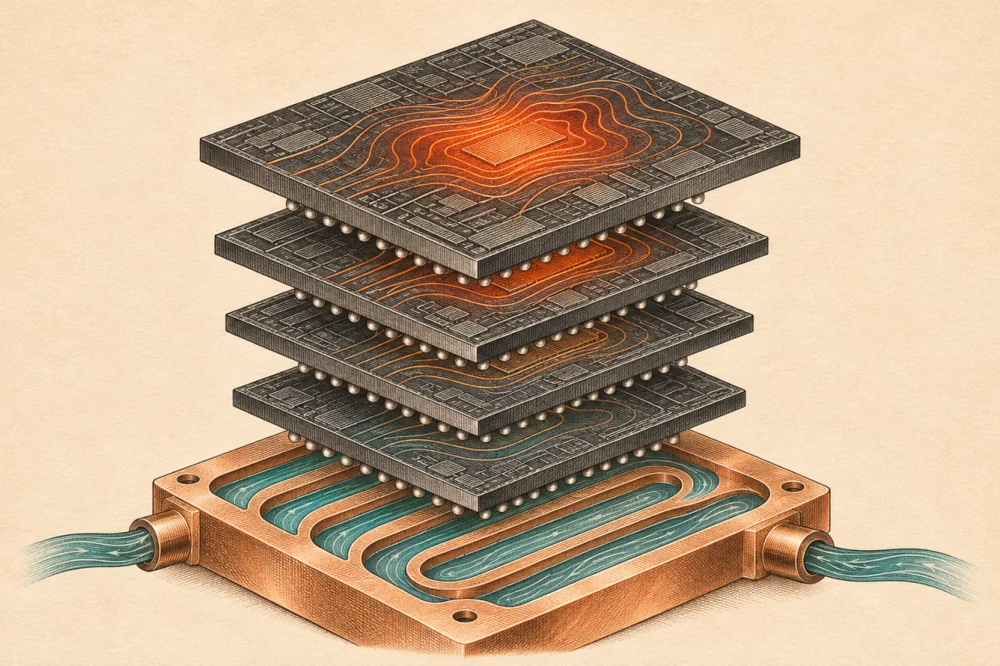

<main class="academic-home" id="main-content">
  <header class="profile-intro">
    

      
Electronic &amp; Computer Engineering / HKUST

      <h1>Haoning Jiang 蒋浩宁</h1>
      
I study AI chips and computer architecture, with a focus on thermal simulation and machine learning for chip design.

      
I’m a Ph.D. student at the <a href="https://hkust.edu.hk/">Hong Kong University of Science and Technology</a>, advised by <a href="https://eeweiz.home.ece.ust.hk">Prof. Wei Zhang</a>. I received my B.S. in Electrical and Electronic Engineering from <a href="https://www.sustech.edu.cn/en/">SUSTech</a> in 2026.

      <nav class="profile-links" aria-label="Contact and academic profiles">
        <a class="profile-cv" href="/HaoningJiang-Jiang-CV.pdf">Download CV ↓</a>
        <a href="mailto:{{ site.author.email }}">Email</a>
        <a href="{{ site.author.googlescholar | escape }}">Google Scholar</a>
        <a href="https://github.com/{{ site.author.github }}">GitHub</a>
      </nav>
    

    

  </header>

  <article class="cover-paper" aria-labelledby="cover-title">
    <figure class="cover-art">
      
      <figcaption>Stacked dies and a liquid cooling plate. Concept illustration.</figcaption>
    </figure>
    

      
DATE 2027 / First-author paper

      <h2 id="cover-title">HiTS</h2>
      
Unified High-Resolution Thermal Simulation for Air- and Liquid-Cooled 2.5D and 3D Integrated Systems

      
<strong>Haoning Jiang</strong>, Hongbang Wu, Jian Peng, Darong Huang, Jiang Xu, and Wei Zhang

      <a class="cover-link" href="/publication/hits-date-2027">Paper details →</a>
    

  </article>

  

    <section class="research-index" aria-labelledby="research-heading">
      

        <h2 id="research-heading">Selected research</h2>
        <a href="/publications/">All publications →</a>
      

      <article class="research-entry">
        
ASP-DAC

        <h3><a href="/publication/2026-09-01-glare-analog-sizing">GLARE</a></h3>
        
We use covariance information to guide the search for analog circuit parameters.

      </article>
      <article class="research-entry">
        
DATE 2026 · ISEDA 2026

        <h3><a href="/publication/2025-01-01-grain-analog-layout-migration">GRAIN</a></h3>
        
We use hierarchical placement and routing guides to preserve design intent when moving a layout between process nodes.

      </article>
      <article class="research-entry">
        
AAAI 2026

        <h3><a href="https://ojs.aaai.org/index.php/AAAI/article/view/39388">FD-MAGRPO</a></h3>
        
We group circuit parameters by function so agents can work together to size low-dropout regulators.

      </article>
    </section>

    <aside class="home-notes" aria-labelledby="news-heading">
      
<h2 id="news-heading">Recent news</h2>

      <ul class="news-timeline">
        <li><time datetime="2026-11">Nov 2026</time>
My first-author paper <a href="/publication/hits-date-2027">HiTS</a> was accepted at <strong>DATE 2027</strong>.
</li>
        <li><time datetime="2026-09">Sep 2026</time>
My first-author paper <a href="/publication/2026-09-01-glare-analog-sizing">GLARE</a> was accepted at <strong>ASP-DAC</strong>.
</li>
        <li><time datetime="2026-08">Aug 2026</time>
Our <a href="/publication/2025-01-05-brain-tumor-foundation-model">study on brain tumor diagnosis</a> was accepted by <em>Lancet Digital Life</em>.
</li>
      </ul>
      

        
Earlier news

        <ul class="news-timeline">
          <li><time datetime="2026-07">Jul 2026</time>
I graduated from SUSTech. Our paper <a href="/publication/2026-01-01-hypckt-analog-topology-generation">HypCkt</a> was accepted at MLCAD 2026.
</li>
          <li><time datetime="2026-06">Jun 2026</time>
My first-author paper <a href="/publication/2026-06-01-dentalpsam-miccai">DentalPSAM</a> was accepted at MICCAI 2026.
</li>
          <li><time datetime="2026-03">Mar 2026</time>
Our paper <a href="/publication/2025-01-01-grain-analog-layout-migration">GRAIN</a> was accepted at ISEDA 2026.
</li>
        </ul>
      

      <section class="home-service">
        <h2>Academic service</h2>
        
Program committee member and reviewer for AAAI 2026 and 2027. Reviewer for CVPR 2026 and IEEE TCAD.

        <a href="/cv/">CV and awards →</a>
      </section>
    </aside>
  

</main>
