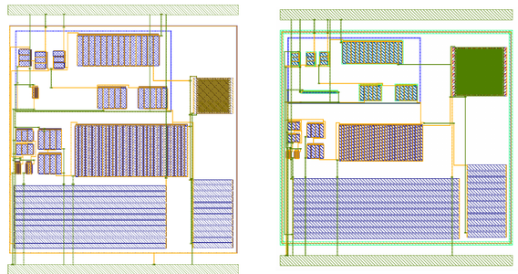
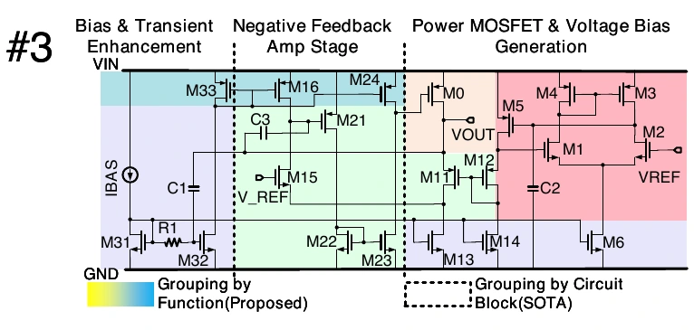

<main class="academic-home" id="main-content" tabindex="-1">
  <header class="profile-summary" aria-labelledby="profile-name">
    

      

      

        <h1 id="profile-name">Haoning Jiang</h1>
        
蒋浩宁

      

    

    
Ph.D. student in Electronic and Computer Engineering at <a href="https://hkust.edu.hk/">HKUST</a>.

    
I study AI chips and computer architecture, with a focus on thermal simulation and machine learning for chip design.

    
I’m advised by <a href="https://eeweiz.home.ece.ust.hk">Prof. Wei Zhang</a>. I received my B.S. in Electrical and Electronic Engineering from <a href="https://www.sustech.edu.cn/en/">SUSTech</a> in 2026.

    <nav class="contact-links" aria-label="Contact and academic profiles">
      <a href="mailto:{{ site.author.email }}">Email</a>
      <a href="{{ site.author.googlescholar | escape }}">Google Scholar</a>
      <a href="https://github.com/{{ site.author.github }}">GitHub</a>
      <a href="/HaoningJiang-Jiang-CV.pdf">CV (PDF)</a>
    </nav>
  </header>

  <section class="work-index" id="research" tabindex="-1" aria-labelledby="research-title">
    

      <h2 id="research-title">Selected research</h2>
      <a href="/publications/">All publications →</a>
    

    <article class="work-row">
      

        

          
DATE 2027

          <h3><a href="/publication/hits-date-2027">HiTS</a></h3>
        

        
Unified High-Resolution Thermal Simulation for Air- and Liquid-Cooled 2.5D and 3D Integrated Systems

        
<strong>Haoning Jiang</strong>, Hongbang Wu, Jian Peng, Darong Huang, Jiang Xu, and Wei Zhang

        <a class="work-link" href="/publication/hits-date-2027">Paper details →</a>
      

      <figure class="work-figure">
        
        <figcaption>Stacked dies and cooling plate · Illustration</figcaption>
      </figure>
    </article>
    <article class="work-row">
      

        

          
ISEDA 2026 · DATE 2026

          <h3><a href="/publication/2025-01-01-grain-analog-layout-migration">GRAIN</a></h3>
        

        
A Design-Intent-Driven Analog Layout Migration Framework

        
B. Liu, <strong>H. Jiang</strong>, H. Zhang, X. Gao, Z. Kong, X. Tang, D. Z. Pan, and Y. Lin

        <a class="work-link" href="/publication/2025-01-01-grain-analog-layout-migration">Paper details →</a>
      

      <figure class="work-figure">
        
        <figcaption>65 nm → 40 nm · GRAIN, Fig. 5</figcaption>
      </figure>
    </article>
    <article class="work-row">
      

        

          
AAAI 2026

          <h3><a href="https://ojs.aaai.org/index.php/AAAI/article/view/39388">FD-MAGRPO</a></h3>
        

        
Functionality-Driven Multi-Agent Group Relative Policy Optimization for Analog-LDO Sizing

        
<strong>H. Jiang</strong>*, H. Wu*, Y. Ou, Z. Wang, T. Chen, and J. Jiang (* equal contribution)

        
<a class="work-link" href="https://ojs.aaai.org/index.php/AAAI/article/view/39388">Paper ↗</a><a class="work-link" href="/files/AAAI26_FD_MAGRPO_Poster.pdf">Poster ↗</a>

      

      <figure class="work-figure">
        
        <figcaption>Regulator topology 3 · AAAI poster</figcaption>
      </figure>
    </article>
    
Related work on analog sizing · <a href="/publication/2026-09-01-glare-analog-sizing">GLARE (ASP-DAC)</a>

  </section>

  <section class="research-news" id="news" tabindex="-1" aria-labelledby="news-title">
    
<h2 id="news-title">News</h2>

    <ul class="dated-list">
      <li><time datetime="2026-11">Nov 2026</time>My first-author paper <a href="/publication/hits-date-2027">HiTS</a> was accepted at <strong>DATE 2027</strong>.</li>
      <li><time datetime="2026-09">Sep 2026</time>My first-author paper <a href="/publication/2026-09-01-glare-analog-sizing">GLARE</a>, on reinforcement learning for analog sizing, was accepted at <strong>ASP-DAC</strong>.</li>
      <li><time datetime="2026-08">Aug 2026</time>Our <a href="/publication/2025-01-05-brain-tumor-foundation-model">brain tumor diagnosis paper</a> was accepted by <em>Lancet Digital Life</em>.</li>
    </ul>
    

      
Earlier news

      <ul class="dated-list">
        <li><time datetime="2026-07">Jul 2026</time>I graduated from SUSTech. Our paper <a href="/publication/2026-01-01-hypckt-analog-topology-generation">HypCkt</a> was accepted at MLCAD 2026.</li>
        <li><time datetime="2026-06">Jun 2026</time>My first-author paper <a href="/publication/2026-06-01-dentalpsam-miccai">DentalPSAM</a> was accepted at MICCAI 2026.</li>
        <li><time datetime="2026-03">Mar 2026</time>Our paper <a href="/publication/2025-01-01-grain-analog-layout-migration">GRAIN</a> was accepted at ISEDA 2026.</li>
      </ul>
    

  </section>

  <section class="academic-service" aria-labelledby="service-title">
    <h2 id="service-title">Academic service</h2>
    
Program committee member and reviewer for AAAI 2026 and 2027. Reviewer for CVPR 2026 and IEEE TCAD.

    <a class="work-link" href="/cv/">Full CV and awards →</a>
  </section>
</main>
